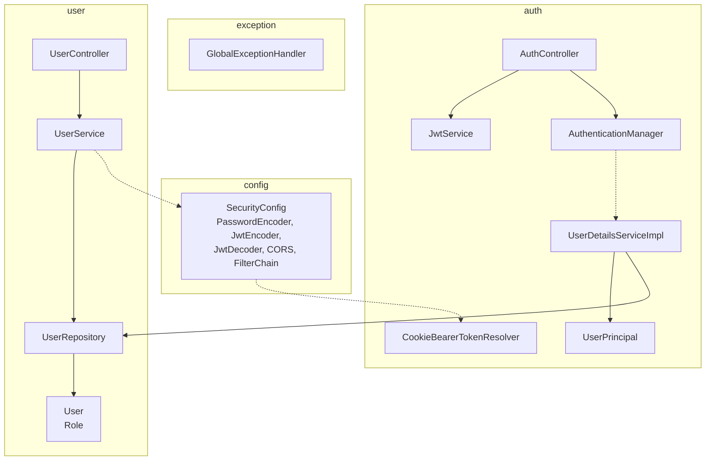

# Pacotes do backend

O backend segue organização por domínio (feature) em vez de por camada técnica. Cada pacote carrega seu próprio controller, service, repository e DTOs.

## Responsabilidades

| Pacote | Responsabilidade |
|---|---|
| `config` | Configuração de segurança: encoder de senha, chaves e beans JWT, CORS e `SecurityFilterChain` |
| `exception` | `GlobalExceptionHandler`, que traduz exceptions em respostas `ProblemDetail` |
| `auth` | Login/logout, geração do JWT, leitura do token a partir do cookie e integração com o Spring Security (`UserPrincipal`, `UserDetailsServiceImpl`) |
| `user` | Entidade `User`, cadastro e consulta do usuário autenticado (`/users/me`) |

## Convenções

- `UserPrincipal` é um adapter: a entidade `User` não implementa `UserDetails`, mantendo o domínio livre de dependências do Spring Security.
- Nomes de classes, campos, tabelas e colunas são sempre em inglês.
- Testes espelham a estrutura de pacotes em `src/test/java`.
