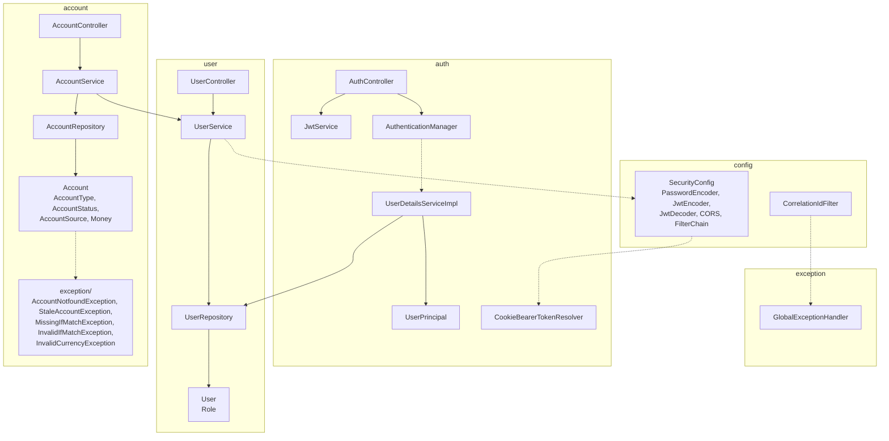

# Pacotes do backend

O backend segue organização por domínio (feature) em vez de por camada técnica. Cada pacote carrega seu próprio controller, service, repository e DTOs.

## Responsabilidades

| Pacote | Responsabilidade |
|---|---|
| `config` | Configuração de segurança: encoder de senha, chaves e beans JWT, CORS (incluindo `PATCH`, `If-Match` e `ETag` exposto), `SecurityFilterChain` e correlation id |
| `exception` | `GlobalExceptionHandler`, que traduz exceptions em respostas `ProblemDetail` (RFC 9457) |
| `auth` | Login/logout, geração do JWT, leitura do token a partir do cookie e integração com o Spring Security (`UserPrincipal`, `UserDetailsServiceImpl`) |
| `user` | Entidade `User`, cadastro e consulta do usuário autenticado (`/users/me`) |
| `account` | Contas manuais, saldo de abertura, origem da conta e isolamento por usuário |

## Convenções

- `UserPrincipal` é um adapter: a entidade `User` não implementa `UserDetails`, mantendo o domínio livre de dependências do Spring Security.
- Entidades usam Lombok apenas onde é seguro: `@Getter` e `@NoArgsConstructor(access = PROTECTED)`. Não há `@Setter`, `@AllArgsConstructor` nem `@Builder` em `Account`/`Money`, para preservar invariantes financeiras.
- DTOs são `record` (`UserResponse`, `AccountResponse`, etc.).
- Services e controllers usam injeção por construtor explícito.
- Nomes de classes, campos, tabelas e colunas são sempre em inglês.
- Testes espelham a estrutura de pacotes em `src/test/java`; o helper de JWT fica em `support/SecurityTestSupport`.
