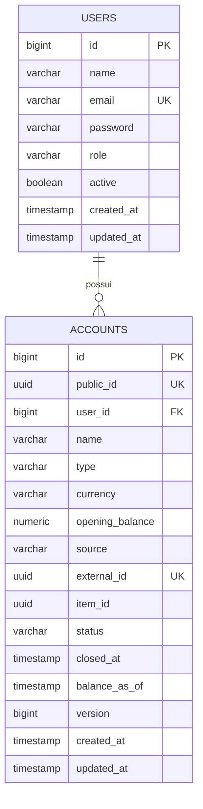

# Modelo de dados

O schema é gerenciado exclusivamente por migrations do Flyway (`backend/opengrana/src/main/resources/db/migration`). O Hibernate roda com `ddl-auto: validate`, apenas conferindo se as entidades batem com o banco.

> **Status:** `users` e `accounts` estão implementados. Transações, snapshots e conciliação ainda não entraram neste bloco.

`external_id` e `item_id` são reservas para o Open Finance: respectivamente o id da conta e o id da conexão na Pluggy. Contas manuais têm ambos nulos.

## Enums

| Enum | Valores | Persistência |
|---|---|---|
| `Role` | `USER`, `ADMIN` | `EnumType.STRING` |
| `AccountType` | `CHECKING`, `SAVINGS`, `CREDIT_CARD`, `INVESTMENT`, `CASH` | `EnumType.STRING` |
| `AccountStatus` | `ACTIVE`, `ARCHIVED`, `CLOSED` | `EnumType.STRING` |
| `AccountSource` | `MANUAL`, `PLUGGY` | `EnumType.STRING` |

## Convenções

- **Valores monetários** usam `NUMERIC(19,4)` no banco e `BigDecimal` + value object `Money` em Java, nunca `double` ou `float`. A escala de negócio vem de `Currency.getDefaultFractionDigits()` (BRL = 2) e o arredondamento é `HALF_UP` explícito na borda. Na API o valor é string (`"1500.00"`).
- **`created_at` e `updated_at`** são preenchidos pelo banco (`DEFAULT now()` e trigger de `updated_at`). Nas entidades, os campos usam `insertable = false, updatable = false` e `@Generated`, para o Hibernate reler o valor gerado após o `save()`.
- **`balance_as_of`** é a data/hora daquele saldo. Não usar `updated_at` para esse fim: ele muda quando a conta é renomeada.
- **Defaults do banco** (`role`, `active`, `status`, `source`) são replicados no Java, porque o Hibernate envia todos os campos mapeados no `INSERT` e o `DEFAULT` do banco não chegaria a ser usado.
- **Identidade:** `id BIGSERIAL` é interno; `public_id` é UUIDv7 exposto na API; `external_id` é o UUID da Pluggy. São três conceitos distintos.
- **Isolamento por usuário:** toda consulta de dados de domínio deve filtrar pelo dono (`user_id`). Recurso de outro usuário responde `404`, nunca `403`.
- **Concorrência:** `@Version` é exposto como `ETag`; `PATCH`/`DELETE` exigem `If-Match`, divergência responde `412`.
- **Encerramento:** `DELETE /accounts/{publicId}` muda o status para `CLOSED`; nunca há delete físico.
- **Migrations aplicadas nunca são editadas.** Mudanças viram uma nova migration.
