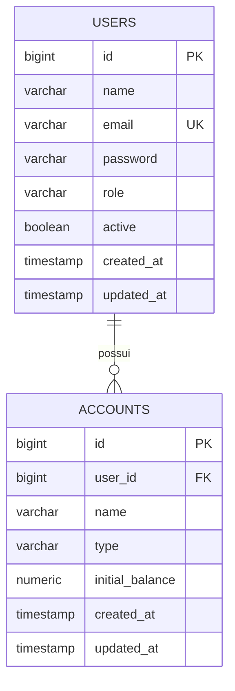

# Modelo de dados

O schema é gerenciado exclusivamente por migrations do Flyway (`backend/opengrana/src/main/resources/db/migration`). O Hibernate roda com `ddl-auto: validate`, apenas conferindo se as entidades batem com o banco.

> **Status:** a tabela `users` existe. A tabela `accounts` está em desenvolvimento (issue de contas e transações) e aparece abaixo como referência do desenho previsto.

## Enums

| Enum | Valores | Persistência |
|---|---|---|
| `Role` | `USER`, `ADMIN` | `EnumType.STRING` |
| `AccountType` (previsto) | `CHECKING`, `SAVINGS`, `CREDIT_CARD`, `INVESTMENT`, `CASH` | `EnumType.STRING` |

## Convenções

- **Valores monetários** usam `NUMERIC(15,2)` no banco e `BigDecimal` em Java, nunca `double` ou `float`.
- **`created_at` e `updated_at`** são preenchidos pelo banco (`DEFAULT now()` e trigger de `updated_at`). Nas entidades, os campos usam `insertable = false, updatable = false` e `@Generated`, para o Hibernate reler o valor gerado após o `save()`.
- **Defaults do banco** (`role`, `active`) são replicados no Java, porque o Hibernate envia todos os campos mapeados no `INSERT` e o `DEFAULT` do banco não chegaria a ser usado.
- **Isolamento por usuário:** toda consulta de dados de domínio deve filtrar pelo dono (`user_id`). Recurso de outro usuário responde `404`, nunca `403`.
- **Migrations aplicadas nunca são editadas.** Mudanças viram uma nova migration.
