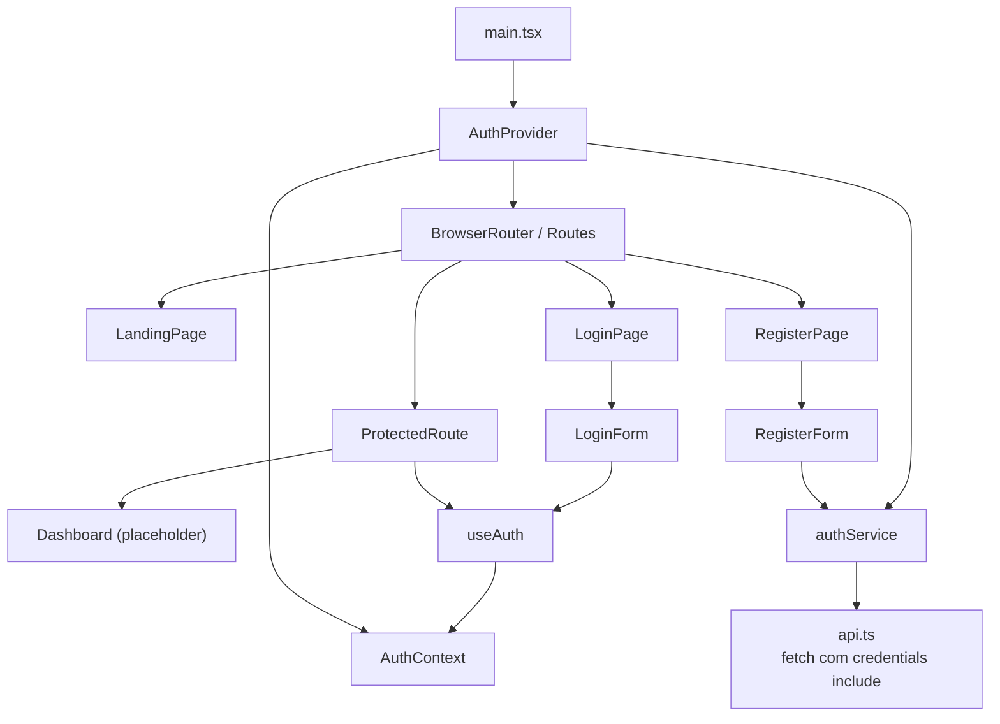

# Estrutura do frontend

SPA em React com Vite, organizada por feature. Componentes genéricos ficam em `shared/`; tudo que é específico de um domínio (formulários, páginas, serviços) fica dentro da própria feature.



## Estrutura de pastas

```
src/
├── features/
│   ├── auth/
│   │   ├── components/     LoginForm, RegisterForm
│   │   ├── pages/          LoginPage, RegisterPage
│   │   ├── AuthContext.ts  só o createContext
│   │   ├── AuthProvider.tsx
│   │   ├── useAuth.ts
│   │   ├── authService.ts
│   │   └── types.ts
│   └── landing/
│       ├── components/     AsciiGlobe
│       └── pages/          LandingPage
├── shared/
│   ├── components/
│   │   ├── ui/             componentes do shadcn/ui
│   │   └── ProtectedRoute.tsx
│   └── lib/utils.ts
└── services/
    └── api.ts              cliente HTTP base
```

## Decisões relevantes

- **Estado de autenticação com Context API.** A sessão muda raramente (login e logout), então o Context é suficiente. Zustand pode ser considerado depois, para estado de UI de alta frequência (como filtros de transações).
- **Sem token no JavaScript.** O `AuthProvider` descobre se há sessão chamando `GET /users/me` ao montar. `isAuthenticated` é derivado da existência do usuário carregado.
- **`AuthContext` e `AuthProvider` em arquivos separados**, por causa da regra do Fast Refresh (um arquivo deve exportar apenas componentes).
- **`credentials: 'include'`** em todas as requisições do `api.ts`, para o navegador enviar e aceitar o cookie de sessão.
