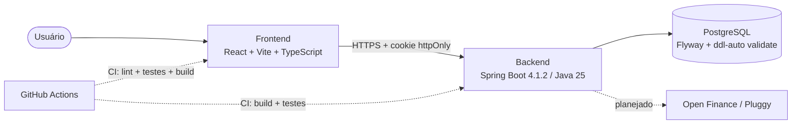

# Visão geral da arquitetura

O OpenGrana é uma aplicação de finanças pessoais open source, organizada como um repositório único com backend e frontend separados por pasta. O backend expõe uma API REST consumida por uma SPA. **Contas manuais já estão implementadas**; transações e a integração com o Open Finance estão planejadas para as próximas fases (ver [ADR 0006](../adr/0006-transacoes.md)).

## Stack

| Camada | Tecnologias |
|---|---|
| Backend | Java 25, Spring Boot 4.1.2, Spring Data JPA, Spring Security (JWT em cookie), Flyway, Hibernate, PostgreSQL, Maven |
| Frontend | React, TypeScript, Vite, Tailwind CSS, shadcn/ui, TanStack Query |
| Testes | JUnit, Mockito, Testcontainers, `@WebMvcTest`, `@DataJpaTest`, Vitest |
| CI | GitHub Actions |

## Princípios adotados

- **Monolito modular:** um único deploy no backend, com pacotes organizados por domínio (`user`, `auth`, `account`, `config`, `exception`). Ver [Pacotes do backend](backend-packages.md).
- **Schema versionado:** o banco só muda por migrations do Flyway, com Hibernate em `ddl-auto: validate` (ver [ADR 0001](../adr/0001-flyway-migrations.md)).
- **Contrato de erro padronizado:** todas as respostas de erro seguem a RFC 9457, com `type` estável e `traceId` (ver [ADR 0003](../adr/0003-problem-details-for-errors.md)).
- **Sessão em cookie `httpOnly`:** o frontend nunca acessa o token (ver [ADR 0002](../adr/0002-jwt-in-httponly-cookie.md)).
- **Isolamento por usuário:** o dono do recurso vem do JWT, nunca do corpo da requisição; recurso de outro usuário responde `404`.
- **Dinheiro exato:** `BigDecimal` + `NUMERIC(19,4)` no banco e string na API (ver [ADR 0004](../adr/0004-representacao-de-dinheiro.md)).
- **Concorrência otimista:** `@Version` exposto como `ETag`, com `If-Match` em escritas (ver [ADR 0008](../adr/0008-ciclo-de-vida-e-concorrencia.md)).
- **Rastreabilidade:** toda requisição recebe um `X-Request-Id`, que também aparece como `traceId` nos erros.

## Documentação por área

| Área | Documento |
|---|---|
| Modelo de dados e enums | [Modelo de dados](data-model.md) |
| Organização dos pacotes | [Pacotes do backend](backend-packages.md) |
| Estrutura da SPA | [Estrutura do frontend](frontend-structure.md) |
| Cadastro e login | [Cadastro](../flows/registration.md) e [Autenticação](../flows/authentication.md) |
| Contas manuais | [Fluxo de contas](../flows/accounts.md) |
| Erros da API | [Tratamento de erros](../flows/error-handling.md) |
| Decisões registradas | [Índice de ADRs](../adr/README.md) |
