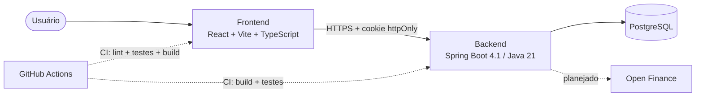

# Visão geral da arquitetura

O OpenGrana é uma aplicação de finanças pessoais open source, organizada como um repositório único com backend e frontend separados por pasta. O backend expõe uma API REST consumida por uma SPA. A integração com o Open Finance é planejada, mas ainda não existe.

## Stack

| Camada | Tecnologias |
|---|---|
| Backend | Java 21, Spring Boot 4.1, Spring Data JPA, Spring Security (JWT), Flyway, PostgreSQL, Maven |
| Frontend | React, TypeScript, Vite, Tailwind CSS, shadcn/ui, TanStack Query |
| Testes | JUnit, Mockito, Testcontainers, `@WebMvcTest`, Vitest |
| CI | GitHub Actions |

## Princípios adotados

- **Monolito modular:** um único deploy no backend, com pacotes organizados por domínio (`user`, `auth`, ...).
- **Schema versionado:** o banco só muda por migrations do Flyway (ver [ADR 0001](../adr/0001-flyway-migrations.md)).
- **Contrato de erro padronizado:** todas as respostas de erro seguem a RFC 7807 (ver [ADR 0003](../adr/0003-problem-details-for-errors.md)).
- **Sessão em cookie `httpOnly`:** o frontend nunca acessa o token (ver [ADR 0002](../adr/0002-jwt-in-httponly-cookie.md)).
