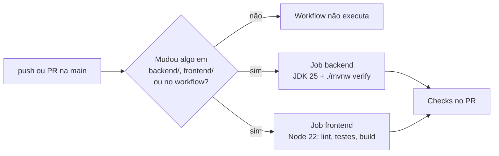

# Pipeline de CI

O CI roda no GitHub Actions (`.github/workflows/ci.yml`) em todo push e pull request para a `main`. O workflow só dispara quando algo relevante muda: o backend, o frontend ou o próprio arquivo do workflow. Alterações apenas em `docs/` não executam build.

## Jobs

| Job | Pasta de trabalho | Etapas |
|---|---|---|
| `backend` | `backend/opengrana` | Checkout, JDK 25 (Temurin) com cache Maven, `./mvnw verify` |
| `frontend` | `frontend/opengrana` | Checkout, Node 22 com cache npm, `npm ci`, `npm run lint`, `npm run test:run`, `npm run build` |

## Configurações de segurança e economia

- `permissions: contents: read`: o token do workflow só lê o repositório.
- `concurrency` com `cancel-in-progress`: um novo push cancela a execução anterior da mesma branch.
- `timeout-minutes`: evita jobs travados consumindo minutos.

## Variáveis de ambiente no CI

O contexto do Spring exige variáveis que localmente vêm do `.env` (que nunca vai para o Git). No CI elas são definidas no `env:` **do job**, com valores fictícios e descartáveis:

- `DB_URL`, `DB_USERNAME`, `DB_PASSWORD`: apontam para o Postgres de serviço do job.
- `JWT_SECRET_KEY`: chave de teste com mais de 32 caracteres.

O perfil ativo é `dev` (padrão em `application.yaml`), então `CORS_ALLOWED_ORIGINS` usa o valor local `http://localhost:5173` e **não** precisa ser definido no CI. A variável só é obrigatória no perfil `prod`, onde não há padrão.

Nunca use no CI os valores reais de produção. Se um workflow futuro (como deploy) precisar de segredos reais, eles devem vir de GitHub Secrets (`${{ secrets.NOME }}`).

> Atenção: o `env:` de um serviço (`services.<nome>.env`) vale apenas para o container desse serviço. Variáveis que a aplicação precisa devem ficar no `env:` do job.

## Testes de integração

Há dois caminhos de banco nos testes:

- `@SpringBootTest` usa o Postgres de serviço do workflow, via `DB_URL` do job.
- `@DataJpaTest` com Testcontainers sobe um `postgres:17` próprio e descartável por classe de teste.

O runner `ubuntu-latest` já traz Docker instalado, necessário para o Testcontainers.

## Melhorias futuras

- Separar backend e frontend em workflows distintos, para que uma mudança só no frontend não dispare o job do backend (o filtro `paths` vale para o workflow inteiro, não por job).
- Job de deploy (`needs: build`) condicionado à `main`.
- Dependabot e análise de qualidade de código.
- Proteção da branch `main` exigindo os checks do CI.
