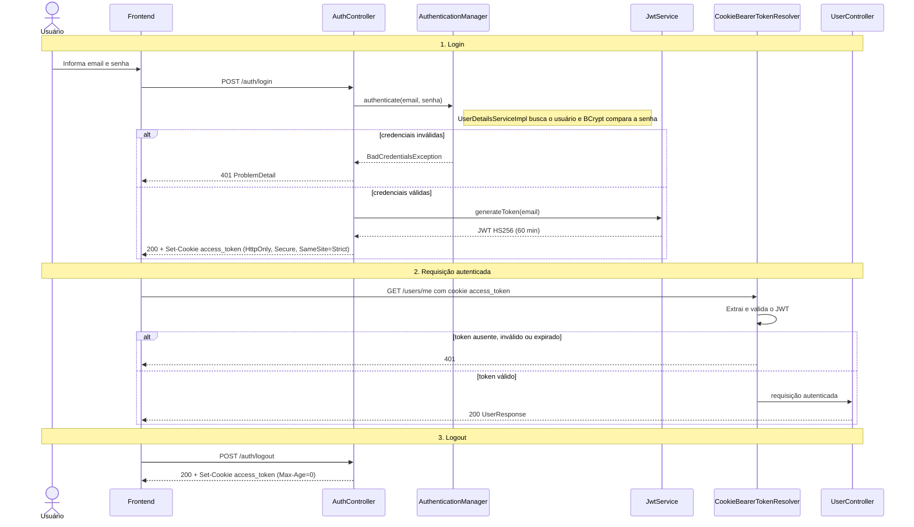

# Autenticação e sessão

Login com email e senha gera um JWT (HS256, 60 minutos) entregue em um cookie `httpOnly`. O frontend nunca lê o token: o navegador o envia automaticamente em cada requisição. Contexto da decisão em [ADR 0002](../adr/0002-jwt-in-httponly-cookie.md).

## Atributos do cookie

| Atributo | Valor | Motivo |
|---|---|---|
| Nome | `access_token` | Nome padrão, reconhecido por ferramentas de debug |
| `HttpOnly` | sim | JavaScript não consegue ler o token (mitiga roubo via XSS) |
| `Secure` | sim | Só trafega por HTTPS (navegadores tratam `localhost` como contexto seguro) |
| `SameSite` | `Strict` | O cookie não é enviado em requisições originadas de outros sites |
| `Path` | `/` | Mesmo valor no login e no logout, para o logout sobrescrever o cookie |
| `Max-Age` | 60 minutos | Alinhado à expiração do JWT |

## Como o frontend sabe se há sessão

Como o token é inacessível ao JavaScript, o `AuthProvider` chama `GET /users/me` ao montar. Se a chamada responde `200`, há sessão; se responde `401`, não há.

## Rotas públicas

`POST /users`, `POST /auth/login` e `POST /auth/logout`. Todas as demais exigem autenticação.

## CORS

Origens permitidas vêm de `cors.allowed-origins` (variável `CORS_ALLOWED_ORIGINS`), nunca `*`, porque a API usa credenciais. Em desenvolvimento: `http://localhost:5173`.

## Limitações conhecidas

- **Token não revogável:** o logout apenas instrui o navegador a descartar o cookie. Um token já emitido continua válido até expirar, e desativar um usuário (`active = false`) não derruba tokens existentes.
- **Sem rate limiting** nem bloqueio de conta após tentativas falhas de login.
- **Sem verificação de email** no cadastro.

Todos esses pontos estão registrados como issues de segurança no repositório.
