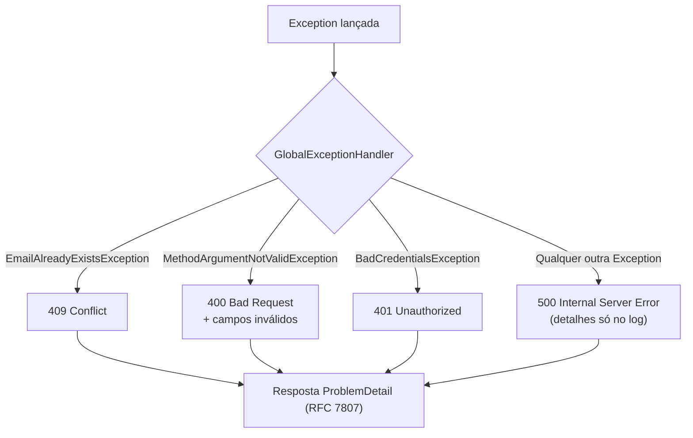

# Tratamento de erros

Todas as respostas de erro da API seguem a [RFC 7807 (Problem Details)](https://datatracker.ietf.org/doc/html/rfc7807), usando a classe `ProblemDetail` do Spring. O tratamento é centralizado no `GlobalExceptionHandler` (`@RestControllerAdvice`). Contexto da decisão em [ADR 0003](../adr/0003-problem-details-for-errors.md).



## Mapeamento atual

| Exception | Status | Observação |
|---|---|---|
| `EmailAlreadyExistsException` | 409 | Mensagem inclui o email informado |
| `MethodArgumentNotValidException` | 400 | Inclui a lista `errors` com `field` e `message` |
| `BadCredentialsException` | 401 | Mensagem genérica, sem distinguir email inexistente de senha errada |
| `Exception` (genérico) | 500 | Mensagem genérica; stacktrace só no log do servidor |

## Exemplos de resposta

Email duplicado:

```json
{
  "title": "Email already in use",
  "status": 409,
  "detail": "Email already in use: test@email.com"
}
```

Validação:

```json
{
  "title": "Validation failed",
  "status": 400,
  "detail": "One or more fields are invalid",
  "errors": [
    { "field": "email", "message": "must not be blank" }
  ]
}
```

## Decisões de segurança

- **Login:** a resposta de credenciais inválidas nunca diferencia "email não encontrado" de "senha incorreta", para impedir enumeração de contas.
- **Erro genérico (500):** nunca devolve `ex.getMessage()`, para não vazar detalhes internos (tabelas, bibliotecas, caminhos).
- **Recurso de outro usuário:** responde `404`, não `403`, para não confirmar que o recurso existe.

## Como adicionar uma nova exception

1. Criar a exception de negócio (estendendo `RuntimeException`).
2. Adicionar um método `@ExceptionHandler` no `GlobalExceptionHandler` com o status semanticamente correto.
3. Cobrir o cenário com um teste `@WebMvcTest`.

Não é preciso mexer em controllers.
