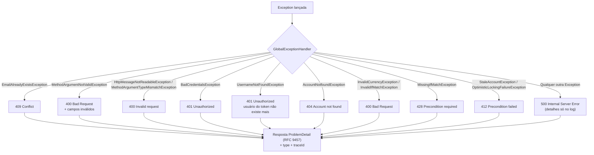

# Tratamento de erros

Todas as respostas de erro da API seguem a [RFC 9457 (Problem Details)](https://www.rfc-editor.org/rfc/rfc9457), usando a classe `ProblemDetail` do Spring. O tratamento é centralizado no `GlobalExceptionHandler` (`@RestControllerAdvice`). Contexto da decisão em [ADR 0003](../adr/0003-problem-details-for-errors.md).

O filtro `CorrelationIdFilter` aceita `X-Request-Id` ou gera um UUID, devolve o header na resposta e coloca o valor no `MDC` como `traceId`. Quando há erro, o `ProblemDetail` inclui `traceId`.



## Mapeamento atual

| Exception | Status | `type` |
|---|---|---|
| `EmailAlreadyExistsException` | 409 | `email-already-in-use` |
| `MethodArgumentNotValidException` | 400 | `validation-failed` |
| `HttpMessageNotReadableException`, `MethodArgumentTypeMismatchException` | 400 | `invalid-request` |
| `BadCredentialsException` | 401 | `invalid-credentials` |
| `UsernameNotFoundException` | 401 | `user-not-found` |
| `AccountNotfoundException` | 404 | `account-not-found` |
| `InvalidCurrencyException` | 400 | `invalid-currency` |
| `InvalidIfMatchException` | 400 | `invalid-if-match` |
| `MissingIfMatchException` | 428 | `if-match-required` |
| `StaleAccountException`, `OptimisticLockingFailureException` | 412 | `stale-version` |
| `Exception` (genérico) | 500 | `internal-error` |

## Exemplos de resposta

Conta não encontrada ou de outro usuário:

```json
{
  "type": "https://opengrana.dev/problems/account-not-found",
  "title": "Account not found",
  "status": 404,
  "detail": "Account not found or does not belong to the authenticated user",
  "traceId": "0c9e5e0b-6f6a-4f2a-9f2c-1b6d0f0a2f3d"
}
```

Validação:

```json
{
  "type": "https://opengrana.dev/problems/validation-failed",
  "title": "Validation failed",
  "status": 400,
  "detail": "One or more fields are invalid",
  "errors": [
    { "field": "email", "message": "must not be blank" }
  ]
}
```

## Decisões de segurança

- **Login:** a resposta de credenciais inválidas nunca diferencia "email não encontrado" de "senha incorreta", para impedir enumeração de contas.
- **Usuário removido com token válido:** responde `401`, não `500`. O email vem do próprio token já autenticado, então a resposta genérica não cria vetor de enumeração.
- **Recurso de outro usuário:** responde `404`, não `403`, para não confirmar que o recurso existe.
- **Erro genérico (500):** nunca devolve `ex.getMessage()`, para não vazar detalhes internos (tabelas, bibliotecas, caminhos).
- **`type` é URI estável:** o cliente deve programar contra ele, não contra `detail`.

## Como adicionar uma nova exception

1. Criar a exception de negócio (estendendo `RuntimeException`).
2. Adicionar um método `@ExceptionHandler` no `GlobalExceptionHandler` com o status semanticamente correto e um `type` estável.
3. Cobrir o cenário com um teste `@WebMvcTest`.

Não é preciso mexer em controllers.
