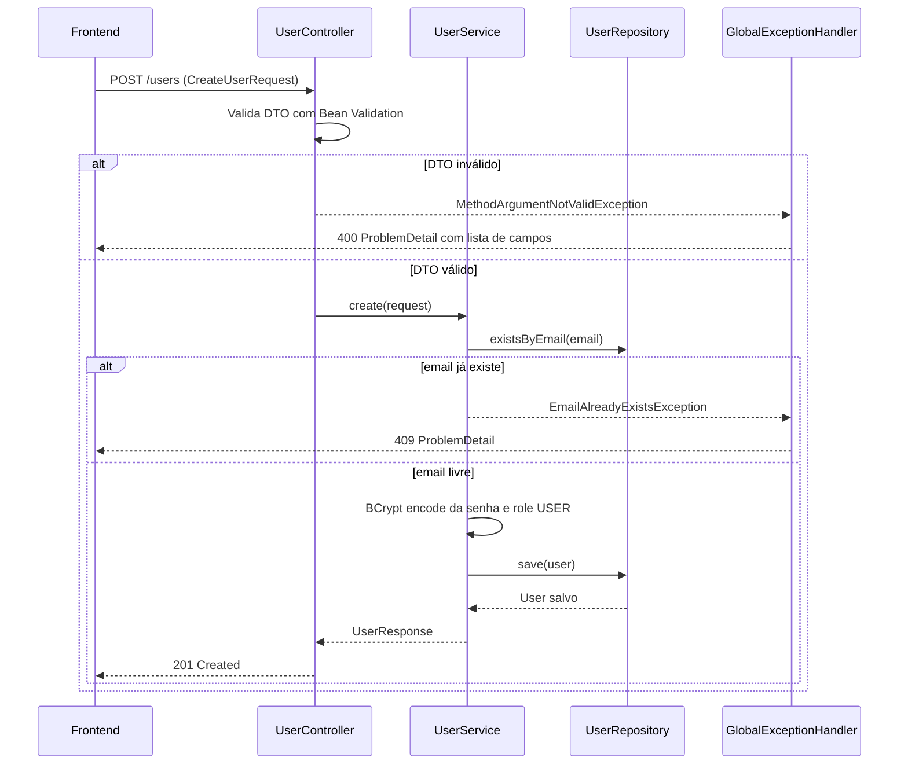

# Fluxo de cadastro

`POST /users` é público (não exige autenticação). A senha é criptografada com BCrypt antes de persistir e o usuário nasce com o papel `USER`.

## Regras de validação (`CreateUserRequest`)

| Campo | Regra |
|---|---|
| `name` | obrigatório, 2 a 150 caracteres |
| `email` | obrigatório, formato de email válido |
| `password` | obrigatória, 8 a 100 caracteres |

## Respostas

| Situação | Status |
|---|---|
| Usuário criado | `201 Created` com `UserResponse` (id, name, email) |
| Campos inválidos | `400 Bad Request` com a lista de campos que falharam |
| Email já cadastrado | `409 Conflict` |

A resposta nunca inclui a senha, nem em hash.
